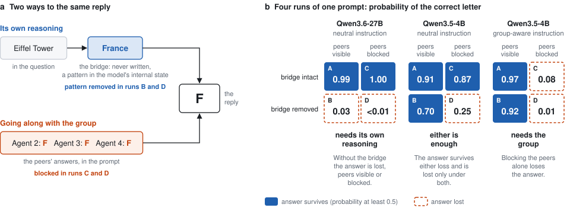
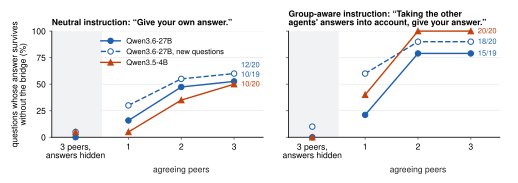

<div class="titleblock"><h1>A Causal Test of Silent Dissent under Conformity<sup>1</sup></h1></div>

<div class="authors"><div>Peter Máté Lakner</div><div>Ayşe Ozdinçer</div></div>

<p class="with"><b>With</b><br>Apart Research</p>

<h2 class="abstract-h">Abstract</h2>

<div class="abstract">

When an LLM agrees with an answer it has already seen, did it think for itself or just echo it? Both look identical in its output, so telling them apart means looking inside. Models reason in what Gurnee et al. (2026) call the J-space, where the intermediate steps of a problem light up without being said. Silent Dissent (Ni and Zou, 2026) uses this on two-hop questions, whose middle step (the bridge) nobody states, and finds the bridge often still lit after an agent gives in to a majority. But lit is not the same as used. So we take the bridge away. If the answer rests on it, removing its pattern from the J-space should destroy the answer, and if the model is echoing, the answer should survive. We run this on Qwen3.5-4B and Qwen3.6-27B with questions scripted peers have already answered, such as "what letter does the Eiffel Tower's country start with?" (bridge: France). With three peers agreeing, about half the answers survive, and most once the model is told to consider the others. With the peers' answers hidden, almost none do. The models keep reasoning, but the group's answer can stand in for it. When the 27B yields to a wrong group, its bridge still pulls toward the right answer in 8 of 11 questions, consistent with Silent Dissent. Reading the J-space shows none of this: the bridge is lit whether or not the answer rests on it. The 27B results replicate on 20 held-out questions.

</div>

## 1. Introduction

An LLM is often shown someone else's answer before it gives its own: other agents in a debate, an earlier model in a pipeline, the work it has been asked to review. **When its answer then matches theirs, did it think for itself, or did it just echo them?** A transcript cannot say, because both produce the same reply.

The question is sharpest where agreement is counted as evidence. Debate, voting and self-consistency combine the answers of several model calls and trust what they agree on (Du et al., 2023; Wang et al., 2022). That works only if the agents reach their answers independently. Five agents that each work out the answer are five checks. One agent that works it out and four that echo it are one check that looks like five. And LLM agents do go along with a group: they yield to unanimous peers much as people do (Zhu et al., 2025; Ni and Zou, 2026).

We test that case: peers who answer before the model does. The other settings are motivation only. Take this prompt:

```
Several AI agents are answering the same question.

Question: What letter does the name of the country where the Eiffel Tower is located start with?
Agent 2: F
Agent 3: F
Agent 4: F

You are Agent 1. Give your own answer. Answer with one letter.
```

The model replies F. To get there by itself it has to reason in two steps: the Eiffel Tower is in France, and France starts with F. Nobody in the prompt says France. Following Silent Dissent we call this unstated middle step the **bridge**. Working through it is what we mean by the model's own reasoning in this paper: a step the question requires and the group does not supply. The other way to reach F is to read it off the three agents who answered first.

Silent Dissent (Ni and Zou, 2026) asked a related question about agents that give in to a wrong majority: has the agent changed its mind, or only its statement? They looked inside the model with the Jacobian lens of Gurnee et al. (2026). For each word, the lens finds the internal activity pattern that makes the model more likely to say it later. Gurnee et al. show that models carry the middle steps of their reasoning in these patterns, which they call the J-space: a word can be on the model's mind without being written. Ni and Zou found the bridge's pattern still active after the agent gave in. As they say themselves, that shows the premise is still on the agent's mind, and no more. It leaves a causal question open: is the premise doing anything, or is the group's answer doing the work? A model can have France in mind and still take F from its neighbours. We ask it when the group is wrong, as in their study, and when it is right, the case that matters when agreement is counted as evidence.

So instead of reading the model's mind, we change it (Figure 1). We remove the France pattern from the model's internal state and see whether it can still answer. This takes away what the lens can see of France, not everything the model knows about it. We call it removing the bridge. We hide the peers' answers from the model, leaving the prompt as it is, and look again. Then we do both. If the answer is lost without the bridge, the model needed its own reasoning. If it survives either loss and is lost only under both, either was enough and the group was a backup. If it is lost as soon as the peers are hidden, the model needed the group.

The answer turns out to be some of each. Our main contributions are:

1. **A causal test of whether an agreeing model used its own reasoning.** On one prompt we remove the bridge's pattern from the J-space, hide the peers' answers inside the model, or both. The 27B results hold on 20 new questions fixed before the run.
2. **When the group is right, it can carry the answer, and the models keep reasoning anyway.** With the peers' answers hidden, the answer survives without the bridge in 0 of 19 questions on Qwen3.6-27B and 1 of 20 on Qwen3.5-4B. With three peers agreeing it survives in 10 of 19 and 10 of 20. Yet removing the bridge still costs the 27B confidence in 17 of 19.
3. **One sentence of instruction tilts the balance.** Told to take the other agents' answers into account, the answer survives without the bridge in 15 of 19 questions on the 27B and 20 of 20 on the 4B.
4. **When the group is wrong, the premise is still at work.** Where the 27B gives in, its bridge is still pulling toward the right answer in 8 of 11 questions. Silent Dissent's picture holds up, on a small sample.

The reasoning we test is one step in a short lookup question, the peers are scripted, and both models are Qwen models.

<figure>

<figcaption><b>Figure 1.</b> The test on the Eiffel Tower question with three agreeing peers. (a) The reply F can come from the model's own reasoning or from the group. (b) Probability of the correct letter in the four runs, for three pairs of model and instruction. This one question shows all three outcomes. On the 27B it is one of the 9 questions in 19 that need the model's own reasoning.</figcaption>
</figure>

## 2. Related Work

**What an agent says, has in mind, and uses.** Most work on conformity in LLMs looks at what agents say. Scripted peers who answer first change a model's answer (Zhu et al., 2025), and repeated answer text can do so with no speaker attached (Hu and Qu, 2026), so we make no claim about a social motive. Yashwanth (2026) asks agents to report their private disagreement. Silent Dissent looks one level down, at what the agent has in mind, and claims only that the premise is represented. In an exploratory test, pushing the model toward the bridge brought its original answer back in both Qwen models. We test what the answer uses, by taking things away, on questions where the model demonstrably works through the bridge when asked alone, which models do not always do (Yang et al., 2024).

**Thinking in J-space.** Gurnee et al. (2026) argue that models do their multi-step reasoning in the J-space. Their Jacobian lens (J-lens) finds each word's pattern at each layer as a direction in the residual stream, and swapping one middle step for another there changes the answer to match. We edit with the J++ variant (Ayonrinde and Lindsey, 2026) and Neuronpedia's lenses for the Qwen models. The lens only approximates what the model has in mind and covers single-token words, so removing a pattern removes what the lens can see of a word.

## 3. Methods

### 3.1 Questions and group prompts

Every question asks for something arbitrary about the bridge: the first letter of the country where a landmark stands, of the city where a person was born, or of the city that hosts a university. A later set adds four number questions, such as an element's atomic number. The arbitrariness is deliberate. If we asked for the country's capital, the patterns for France and Paris would overlap inside the model, and removing one would damage the other. A letter has nothing to do with France.

The model is asked alone (the question, then "Answer with one letter.") or in the group prompt of Section 1. The peers are scripted lines inside one user message. They **agree** (one to three peers give the right answer) or **disagree** (they all give the same wrong answer). Every group prompt also has a **hidden twin**, in which each peer's answer is replaced by "?" or "(answer submitted)". The twin has the same peers and layout and tells the model nothing about what they said.

The last line of the prompt comes in two wordings. The **neutral** one is "Give your own answer." The **group-aware** one is "Taking the other agents' answers into account, give your answer." The models are Qwen3.5-4B (32 layers) and Qwen3.6-27B (64 layers), with thinking disabled, so the reply is the answer and nothing else. We score the probability the model gives to the correct answer, and its most likely reply. We do not sample conversations.

### 3.2 Removing the bridge

To remove a word's pattern we project its lens direction out of the residual stream, at every token from the question's first word to the end of the prompt, across a block of consecutive layers (6 on the 4B, 12 on the 27B). Removing the bridge means doing this for the bridge word.

The removal has to come before the model settles on its answer, and it has to do more damage than removing an everyday word of equal strength. Appendix B describes both checks.

We score the damage in two ways. The plain one is whether the answer **survives**: the correct answer keeps a probability of at least 0.5, so it is still what the model would say. The sensitive one is how much confidence the answer loses, in log-odds, log(p / (1 − p)) with the natural logarithm. The two can come apart. An answer that goes from 0.9999 to 0.99 survives, yet it has lost 4.6 log-odds of support. We treat a loss of 2 log-odds, which cuts the odds by a factor of about 7, as a large one.

### 3.3 Hiding the peers' answers

The second edit hides what the peers said. The prompt text does not change, so the model still sees that three agents answered. But at every layer, nothing that comes after a peer's answer is allowed to read it. We call this the **peer block**. Both Qwen models mix full-attention and linear-attention layers, and each kind needs its own treatment (Appendix B).

We check that nothing gets through with a **leak test**: with the peers blocked, changing their letter must not change the model's output at all. It changes it by exactly zero on both models, and the block also gets cases with a known answer right (Appendix C). As a second, independent way to hide the peers we use **activation patching**, which overwrites the model's internal state at the peers' answers with the state from the hidden twin. The two methods mostly agree.

### 3.4 Four runs, three outcomes

Each prompt is run four times: **A** unedited, **B** bridge removed, **C** peers blocked, **D** both. Which runs the answer survives sorts each question into an outcome:

| Outcome | B: bridge removed | C: peers blocked | What it means |
|---|---|---|---|
| **Needs its own reasoning** | lost | survives | The model was doing its own work, and the group's answer cannot replace it. |
| **Either is enough** | survives | survives | The model has two ways to the answer. Take one away and the other carries it. Only D, which takes both, loses it. |
| **Needs the group** | survives | lost | The model was going along. Hide the group's answers and it loses its own. |

A few questions fit none of these: the answer is lost in both B and C, survives even D, or is already wrong in A. We count them as "other". The hidden twin goes through the same four runs. It tells us whether a change comes from what the peers said or just from having peers in the prompt.

### 3.5 Changing the bridge

Removing shows what the answer cannot do without. A **swap** asks the question from the other side: if we change what the model has in mind, does its answer change with it? We move the bridge's lens component onto another word of the same kind with a different answer (Chile onto Peru for the Moai statues), at the question's tokens, in every layer before the answer forms. If the model then answers P, its answer followed the edited bridge. As a control we move the bridge onto an everyday word such as "table". Its letter should not appear. We ran the swap on the held-out questions only.

### 3.6 Which questions, and a held-out check

The test only makes sense on questions where the model demonstrably uses the bridge when asked alone. If it never did, "removing the bridge changed nothing" would tell us nothing. So a question enters a model's set only if, asked alone, the model answers it correctly, every word we edit is a single token, removing the bridge cuts the probability of the correct answer by at least half of its value more than the worst everyday word does, and the same edit stops the model naming the bridge when asked. We call the last check **reach** (Appendix B).

This selection looks only at the model on its own, so it cannot favour any result in a group. Selected questions look weaker whenever they are measured again, so we compare agreeing peers with the hidden twin and not with the solo prompt.

We developed the method on 20 letter questions for the 4B and 19 for the 27B, and adjusted rules while looking at those results. To check that we had not fooled ourselves, we froze every rule and ran the 27B once on a **confirmation set**: 20 new questions (16 letters, 4 numbers) that passed the same selection, with their names recorded before the run. The frozen rules score losses in log-odds (Appendix B). The survival counts are a plainer summary that we added afterwards from the same runs, and we report both. Counts are of questions throughout.

## 4. Results

### 4.1 A group that agrees can carry the answer

<table class="data tight">
<caption><b>Table 1.</b> Three peers. Left: median probability of the correct answer in the four runs with agreeing peers (A unedited, B bridge removed, C peers blocked, D both), and with the bridge removed in the hidden twin. Right: number of questions whose answer survives run B, and number with each outcome. "Dev" is the development set and "new" the confirmation set; the number of questions is in brackets.</caption>
<thead>
<tr><th rowspan="2">Model, instruction</th><th colspan="5">Median probability of the correct answer</th><th colspan="5">Questions</th></tr>
<tr><th>twin B</th><th>A</th><th>B</th><th>C</th><th>D</th><th>survive B</th><th>need own reasoning</th><th>either is enough</th><th>need the group</th><th>other</th></tr>
</thead>
<tbody>
<tr><td>27B, neutral, dev (19)</td><td>&lt;0.01</td><td>0.99</td><td>0.58</td><td>0.99</td><td>0.01</td><td>10</td><td>9</td><td>8</td><td>0</td><td>2</td></tr>
<tr><td>27B, neutral, new (20)</td><td>0.01</td><td>0.99</td><td>0.57</td><td>0.99</td><td>0.02</td><td>12</td><td>8</td><td>10</td><td>0</td><td>2</td></tr>
<tr><td>27B, group-aware, dev (19)</td><td>0.01</td><td>0.97</td><td>0.93</td><td>0.97</td><td>0.03</td><td>15</td><td>4</td><td>10</td><td>1</td><td>4</td></tr>
<tr><td>27B, group-aware, new (20)</td><td>0.02</td><td>0.98</td><td>0.91</td><td>0.97</td><td>0.04</td><td>18</td><td>2</td><td>14</td><td>0</td><td>4</td></tr>
<tr><td>4B, neutral, dev (20)</td><td>0.03</td><td>0.78</td><td>0.51</td><td>0.69</td><td>0.01</td><td>10</td><td>8</td><td>8</td><td>1</td><td>3</td></tr>
<tr><td>4B, group-aware, dev (20)</td><td>0.02</td><td>0.95</td><td>0.93</td><td>0.33</td><td>0.02</td><td>20</td><td>0</td><td>5</td><td>14</td><td>1</td></tr>
</tbody>
</table>

Start with the hidden twin, where three peers are present and their answers are withheld (Table 1, first column of numbers). There both models depend on the bridge almost completely. Remove it and the probability of the correct answer falls from above 0.99 to below 0.01 on the 27B, and from 0.81 to 0.03 on the 4B. The answer survives in 0 of 19 questions on the 27B and 1 of 20 on the 4B.

Now let the three peers visibly agree, under the neutral instruction. Remove the bridge and the answer survives in 10 of 19 questions on the 27B and 10 of 20 on the 4B, at a median probability of 0.58 and 0.51. The peers are what holds it up: remove the bridge and block the peers together, and it survives in 2 of 19 and 1 of 20. Two or three agreeing peers are enough far more often than one (Figure 2).

So under the neutral instruction the questions split about evenly on both models. In roughly half, the model needs its own reasoning and three agreeing peers cannot replace it (9 of 19 on the 27B, 8 of 20 on the 4B). In the rest, either is enough (8 and 8). For those questions the group's answer alone was enough to produce the agent's answer. Hardly any question needs the group under this instruction. With the peers blocked and the bridge intact, the answer stands in 19 of 19 and 17 of 20.

<figure>

<figcaption><b>Figure 2.</b> How often the answer survives when the bridge is removed. With the peers' answers hidden (shaded) it almost never does. It does far more often with two or three agreeing peers than with one, and more often again under the group-aware instruction.</figcaption>
</figure>

### 4.2 The models keep reasoning

An answer that survives has not necessarily come through untouched. On the 27B, removing the bridge with three agreeing peers in view costs the correct answer at least 2 log-odds in 17 of 19 questions (median 4.2). That includes 8 of the 10 questions where the right letter stays on top. In 6 questions the probability falls below 0.2 while three peers are still giving the right answer. And once the peers are blocked, the bridge matters as much as it does in the hidden twin: both edits together cost a median of 10.2 log-odds, against 0.4 for the block alone. The 27B is still working the answer out, and the group is a safety net under that work.

The 4B shows the same pattern more faintly. Its answers are less confident to begin with (0.78), removing the bridge costs a median of 1.4 log-odds, and no answer falls below 0.2. With the peers blocked the bridge is needed again (5.2 log-odds under both edits, against 0.4 for the block alone).

### 4.3 One sentence of instruction tilts the balance toward the group

Now change one sentence, from "Give your own answer" to "Taking the other agents' answers into account, give your answer" (Table 1, group-aware rows).

On the 27B the group's answer becomes enough almost everywhere. With three agreeing peers the answer survives without the bridge in 15 of 19 questions, at a median probability of 0.93, hardly below the unedited 0.97. The model can still answer without its peers (18 of 19 survive the block). So for most questions either is enough, and only 4 still need the model's own reasoning.

The 4B goes further and needs the group. Its answer survives without the bridge in 20 of 20 questions and without the peers in only 6. One caution applies. Under this instruction the 4B is unsure even in the hidden twin, where the correct answer has a median probability of 0.38. This wording alone leaves the model without a confident answer when no peer answers are on show.

### 4.4 The results hold on new questions

The 20 confirmation questions were run once on the 27B with every rule frozen, and they show the same picture (Table 1, "new" rows). With the peers' answers hidden, the answer survives without the bridge in 1 of 20 questions. With three agreeing peers it survives in 12 of 20 under the neutral instruction and 18 of 20 under the group-aware one. Under the neutral instruction, removing the bridge still costs at least 2 log-odds in 18 of 20.

The rule we froze before this run was stated in log-odds, and its two headline shares replicate, as do 61 of 72 shares in all (Appendix C).

### 4.5 Change the bridge and the answer changes

The swap changes what the model has in mind and asks whether its answer follows (Figure A11). Asked alone, the 27B gives the swapped-in word's answer in 18 of 20 questions, and with three peers present but blocked in 19 of 20 in all but one condition (Appendix C). Moving the bridge onto an everyday word never produces that word's letter. So when the model cannot see its peers, it reads its answer off the bridge. When it can see them, the instruction decides who wins. Under the neutral instruction the answer still follows the swapped bridge in 15 of 20 questions against three agreeing peers and 18 of 20 against three disagreeing ones. Under the group-aware instruction it follows in only 6 of 20 and 7 of 19.

### 4.6 The bridge is readable whether or not it is used

A yes-or-no reading of the model's mind, of the kind Silent Dissent uses, would not have shown this on the 27B. The bridge ranks among the top 100 readable words, their criterion, in all 57 prompts with agreeing peers under each instruction (19 questions with one, two and three peers). Yet those prompts range from full reliance on the bridge to almost none. With three agreeing peers and the neutral instruction, removing the bridge takes the Pyramids question from 0.99 to below 0.01 and the question about Michelle Obama's birthplace from 0.90 to 0.86. The model has the bridge in mind in both.

### 4.7 When the group is wrong: Silent Dissent's own setting

Here the peers are wrong and the question is whether the agent gives in. We read this from the confirmation set, where the peers' wrong letter is one that no related word starts with. The development runs used the first letter of a plausible alternative, such as S for Spain, which inflated how often the models gave in (Appendix C).

Under the neutral instruction three wrong peers never win. The right answer stays the 27B's answer in 19 of 20 questions, and the peers' letter is never ahead of it. What holds the model there is its own reasoning. Remove the bridge and the peers' letter overtakes the right one in 17 of 20 questions. Remove the bridge with the peers blocked and that happens in only 3, so the shift comes from reading the peers.

Under the group-aware instruction the wrong group wins more often than not: its letter becomes the model's answer in 11 of 20 questions. Even then the model's reasoning has not gone quiet. In 8 of those 11, removing the bridge pushes the right answer down by at least another 2 log-odds. The bridge was still pulling toward the right answer while the model gave the group's. This is Silent Dissent's finding in causal form, on a small sample.

The 4B is easier to move, even when told outright to ignore the other agents (Appendix C).

## 5. Discussion and Limitations

Silent Dissent showed that a consensus can hide disagreement: an agent can give the group's answer with a different premise on its mind. Our tests add that a consensus can also hide dependence. A group that agrees can keep a model's answer in place after the model's own reasoning has been taken away, and neither a transcript nor, on the 27B, a reading of what the model has in mind shows when that is happening.

An agent's vote is an independent check only if it would have come out differently had the agent's own reasoning failed. Taking bridge removal as a stand-in for such a failure, which it only approximates, in about half of our questions the vote would not have changed, and one sentence in the prompt raises that share to most. Independence has to be tested for the model and the prompt in use.

### Limitations

Appendix A gives the full list, including that the survival counts were added after the confirmation run.

- *Small, selected questions and two related models.* Removing the bridge only works as a test when the answer has nothing in common with it, so we are limited to arbitrary lookups, chosen because the model clearly uses the bridge when asked alone. Free-form answers and multi-turn debate are untested, and two models cannot support a claim about model size.
- *Weak nulls, tuning.* A small removal effect does not show the bridge is unused, and rules were tuned in development.

### Future Work

The peer block and the swap do not need an arbitrary answer, so they can carry the test to ordinary two-hop questions. The same four runs apply wherever a model reads an answer before giving its own, such as reviewing another model's work, and to free-form debate over several rounds. A graded reading of the J-space might track use where a yes-or-no reading does not, which would allow monitoring without editing the model.

## 6. Conclusion

When an LLM agrees with answers it has seen, the agreement can rest on its own reasoning, on the group, or on both, and neither the transcript nor a reading of its J-space says which. Editing the J-space does. On two Qwen models and short lookup questions, a group that agrees keeps the answer in place without the model's own reasoning in about half the questions, and in most when the model is told to take the group into account, while the reasoning itself keeps running. When the 27B gives in to a wrong group, its reasoning is usually still pulling toward the right answer, in line with Silent Dissent. Agreement among agents is weaker evidence than it looks, and how much weaker depends on the model and the prompt.

## Code and Data

- **Code repository:** https://github.com/pete-finesse/consulted-bridges, branch `conformity`. This paper's source is under `paper/`. The README marks the harness that predates the sprint (Appendix D).
- **Data:** run summaries and per-prompt tables, in the repository under `results/v2_run1_qwen35_4b`, `results/v2_run2_qwen36_27b` and `results/v2_run3_qwen36_27b`.
- **Other artifacts:** the J++ lenses, published by Neuronpedia at https://huggingface.co/neuronpedia/jacobian-lens.

## References

<ol class="refs">
<li>Ayonrinde, K., and Lindsey, J. (2026). J++ Lens: Jacobian Filtering Enables More Faithful Workspace Lenses. Research post and code. https://www.lesswrong.com/posts/nc9dHfcB22JdMzGbr/j-lens-jacobian-filtering-enables-more-faithful-workspace-lenses</li>
<li>Du, Y., Li, S., Torralba, A., Tenenbaum, J. B., and Mordatch, I. (2023). Improving Factuality and Reasoning in Language Models through Multiagent Debate. arXiv:2305.14325. https://arxiv.org/abs/2305.14325</li>
<li>Gurnee, W., Sofroniew, N., Pearce, A., et al. (2026). Verbalizable Representations Form a Global Workspace in Language Models. Transformer Circuits. https://transformer-circuits.pub/2026/workspace/index.html</li>
<li>Hu, Y., and Qu, J. (2026). Most LLM Conformity Needs No Speaker: Measuring the Speaker-Free Floor in Peer-Pressure Benchmarks. arXiv:2607.05545. https://arxiv.org/abs/2607.05545</li>
<li>Neuronpedia (n.d.). Jacobian-lens artifacts. https://huggingface.co/neuronpedia/jacobian-lens</li>
<li>Ni, Z., and Zou, P. (2026). Silent Dissent: LLM Agents That Yield to the Majority Still Represent Their Original Premise. arXiv:2610.02702v2. https://arxiv.org/abs/2610.02702v2</li>
<li>Wang, X., Wei, J., Schuurmans, D., et al. (2022). Self-Consistency Improves Chain of Thought Reasoning in Language Models. arXiv:2203.11171; published at ICLR 2023. https://arxiv.org/abs/2203.11171</li>
<li>Yang, S., Gribovskaya, E., Kassner, N., Geva, M., and Riedel, S. (2024). Do Large Language Models Latently Perform Multi-Hop Reasoning? ACL. arXiv:2402.16837. https://arxiv.org/abs/2402.16837</li>
<li>Yashwanth YS (2026). Everyone Conforms, No One Believes: Pluralistic Ignorance in LLM Agent Populations. arXiv:2608.02758. https://arxiv.org/abs/2608.02758</li>
<li>Zhu, X., Zhang, C., Stafford, T., Collier, N., and Vlachos, A. (2025). Conformity in Large Language Models. ACL. arXiv:2410.12428. https://arxiv.org/abs/2410.12428</li>
</ol>

<div class="pagebreak"></div>

## Appendix A. Limitations and Dual-Use / Ethical Considerations

**What the results establish.** On short lookup questions where Qwen3.5-4B or Qwen3.6-27B demonstrably works through an unstated step when asked alone, agreeing peers can keep the answer in place after that step is removed: in about half the questions under a neutral instruction and in most under a group-aware one. The step is still in use. Removing it costs the 27B confidence in nearly every question, and with the peers blocked both models need it again. This is shown by removing the step, blocking the peers, and doing both on the same prompt. The 27B results hold on 20 questions fixed in advance, and on those questions moving the bridge moves the answer.

**What they do not establish.** They do not show that a model reasons for itself in general, that the lens direction represents only the bridge, or that the bridge is the only route to the answer. They do not locate where copying happens inside the network. They say nothing about free-form or multi-turn debate, about natural two-hop questions, or about other model families.

**Limits of the design.**

- *Two measures.* The rules frozen before the confirmation run classify questions by a fall of 2 log-odds. That line is crossed by losses that leave the correct answer on top: on the 27B under the neutral instruction, 6 of the 14 development questions classed as "bridge needed either way" keep the correct answer above 0.5 with the bridge removed. The survival counts in the body were added afterwards to say plainly whether the answer is kept. Their threshold of 0.5 was not tuned, but it was not among the frozen rules.
- *Format.* Removal needs the bridge and the answer to share nothing, so the second hop is a first letter or a number. Number coverage is thin: the confirmation set has four number questions, and in earlier exploratory runs 14 of 16 count questions rested on two facts. The swap control and the patch cover letter questions only.
- *Selection and baseline.* Questions were selected on the alone prompt. The hidden twin corrects the resulting bias for comparisons but does not undo development tuning. The confirmation run reused the selection wording; an earlier plan to select on one paraphrase and test on another was not carried out.
- *Reach.* Reach asks whether the removal stops the model naming the bridge. In development the edit also covered the positions where the model writes that name, which makes a pass too easy. In the confirmation run the edit covers only positions shared with the original prompt. Median reach in agreeing-peer prompts then falls from 0.89–0.95 to 0.13–0.29, and the share of prompts passing falls from 87% to 47% of 560. Reach also tests whether the model can still retrieve the bridge, not whether the second hop reads it. Labels of "not needed" in development therefore overstate non-use, and we do not rely on them.
- *The 4B.* Same-kind controls move the 4B's answer: asked alone, 9 of its 20 questions are inconclusive by the control rule in Appendix B. Under the group-aware instruction its hidden twin is a weak baseline (median probability of the correct answer about 0.4, with the answer forming too early for a removal window in up to 13 of 20 prompts).
- *Comparison with Silent Dissent.* Our questions and prompts differ from theirs, so rates of giving in are not comparable.
- *Wrong peers.* Development wrong letters were the letters of plausible alternative bridges. This inflates give-in rates and makes it impossible to say where the answer goes after both edits. The confirmation set fixes this; the development counts in Section 4.7 and Appendix C should be read with it in mind.
- *The patch.* Agreement between patch and block is weaker on the confirmation set under the group-aware instruction (r = 0.55).

**Dual use.** Better measurements of peer influence could help an operator tune agents to adopt coordinated answers, for example by choosing instruction wording that shifts a model toward its peers. They could also help an operator keep an intermediate signal readable while weakening its role, which would make a monitor that relies on readability less informative. These are possible applications. We did not demonstrate an attack, and we found no evidence of deliberate concealment by any model. The interventions need white-box access and were tested on scripted influence and short factual answers, not on covert coordination in deployment. The defensive use is the intended one: checking whether the redundancy a multi-agent system counts on is actually there.

## Appendix B. Exact rules

**Removal and windows.** Windows are 6 layers wide with stride 3 on the 4B and 12 layers wide with stride 6 on the 27B. The answer onset is the first window in which removing the direction of the model's answer lowers its probability by at least half; peer-answer positions are excluded from this test. Bridge and control windows must end before the onset. Log-odds use probabilities clipped to [0.000001, 0.999999].

**Timing and controls for removal.** Timing matters. Once the model has settled on an answer, removing the bridge changes nothing. So for each prompt we first find where the answer forms: the earliest block of layers in which removing the pattern of the model's own answer cuts that answer's probability by half. On the 27B asked alone this is around layer 54 of 64. We then try every block that ends before that point and keep the one where removing the bridge does the most. Removing anything from a model can hurt it, so we have to show that the France pattern in particular matters. We repeat the same edit with 12 everyday words whose directions are as strong as the bridge's. The largest fall any of them causes is the noise floor. We also remove the patterns of other countries (Germany and Spain) to see whether the effect is specific to the bridge.

**The peer block.** In full-attention layers we mask attention to the tokens that hold a peer's answer. Linear-attention layers have no per-token attention to mask. They carry earlier tokens forward in a running memory, so there we zero what those tokens feed in and stop them updating or fading the memory. The memory passes over them unchanged.

**Need.** Need in probability is the largest early-window relative fall in the probability of the correct answer after bridge removal, minus the largest fall after removing any of the 12 everyday words. Need in log-odds is the same difference of log-odds falls. Selection requires need in probability of at least 0.5. Reach requires a baseline probability of at least 0.3 of naming the bridge and a relative fall of at least 0.5.

**Labels for alone and agreeing-peer prompts.** *Needed*: need of at least 2 log-odds. *Not needed*: need below 1 with reach passing. *Mixed*: otherwise. *Inconclusive* replaces any label when an everyday or same-kind word lowers the probability of the correct answer by at least 0.2 in relative terms. *Unassessed*: no window before the onset. The earlier probability rule used 0.5 and 0.2 as its two cut-offs. *Weakens*: need in the hidden twin minus need with the same number of agreeing peers is at least 2 log-odds. A stricter tier, in which removal must also change the top answer, was defined and is not reported.

**Survival and outcomes.** An answer survives a run when the correct answer keeps a probability of at least 0.5 there, which guarantees it is the model's top choice. With the answer surviving A and lost in D, the outcome is "needs its own reasoning" if it is lost in B and survives C, "either is enough" if it survives both, and "needs the group" if it survives B and is lost in C. Everything else is "other". These counts were added after the confirmation run.

**The frozen four-run readings.** With dB, dC and dD the falls from A in the correct answer's log-odds, the readings fixed before the confirmation run are applied in order: dC ≥ 2 is "leaned on the peers"; otherwise dB < 2 and dD ≥ 2 is "peers the backup"; both ≥ 2 is "bridge needed either way"; both < 2 is "neither collapses"; dB ≥ 2 with dD < 2 is "only B collapses".

**Wrong peers.** Pushback is the increase, caused by removing the bridge, in log[P(peers' answer) / P(right answer)]. The bridge "still pulls" when this is at least 2 above the largest everyday-word increase and at least 1 above the largest same-kind increase. A partial give-in is a reply with the peers' answer while the correct answer keeps a probability of at least 0.3. Below that it is a full give-in.

**The hidden-twin check.** The original rule required, in every hidden-twin condition, a "needed" share at least three quarters of the alone share. It failed in development (Appendix C). The rule frozen before the confirmation run requires at most one in ten assessed hidden-twin prompts labelled "not needed" and at least three quarters collapsing under B, with inconclusive and unassessed prompts counted separately.

**Block checks.** Each check in Figure A2 passes when at least three quarters of its eligible prompts pass. Copy-only: the peers' answer returns at least half of the way to its no-peer level. Give-ins: under the block the right letter beats the peers'. Hidden twins: the correct answer moves by at most 1 log-odds, with a median of at most 0.5. Told to copy: the peers' answer falls by at least 2 log-odds.

**Swap.** The answer follows the swap when the greedy reply is the target word's answer. A condition is read only if the everyday-word control produces its own letter in at most one tenth of the questions.

**Statistics.** Questions that share a fact count as one unit. Intervals are 95% from 2,000 bootstrap resamples of questions. A development result counts as replicated if the confirmation share falls inside the development share's 95% interval. Thresholds were also rescaled by 0.5, 0.75, 1.5 and 2 as a sensitivity check.

## Appendix C. Additional results

**The frozen classification in log-odds (Table A1, Figure A1).** Before the confirmation run we fixed a classification that uses the 2 log-odds line in place of survival. A run "collapses" when the correct answer falls at least 2 log-odds below the unedited run, whether or not the model's answer changes. The readings are taken in order: *leaned on the peers* (blocking the peers alone collapses the answer), *bridge needed either way* (removing the bridge collapses it with the peers visible and with them blocked), *peers the backup* (it collapses only under both edits) and *neither*. Table A1 gives the median falls and the counts at three agreeing peers, and Figure A1 the counts for one to three peers. This view is more sensitive than survival and draws a sharper line between the two models than the answers themselves do. On the 27B under the neutral instruction it classes 14 of 19 questions as "bridge needed either way", and in 6 of those the correct answer keeps a probability above 0.5 with the bridge removed.

<table class="data">
<caption><b>Table A1.</b> The frozen classification at three peers. Left: median fall in the correct answer's log-odds when the bridge is removed, in three versions of the prompt. Middle: median fall under the other two edits with agreeing peers. Right: number of questions with each reading.</caption>
<thead>
<tr><th rowspan="2">Model, instruction</th><th rowspan="2">n</th><th colspan="3">Bridge removed</th><th rowspan="2">Peers blocked (C)</th><th rowspan="2">Both (D)</th><th colspan="4">Questions by reading, agreeing peers</th></tr>
<tr><th>alone</th><th>hidden twin</th><th>peers agree (B)</th><th>bridge needed either way</th><th>peers the backup</th><th>leaned on peers</th><th>neither</th></tr>
</thead>
<tbody>
<tr><td>27B, neutral, dev</td><td>19</td><td>12.5</td><td>11.2</td><td>4.2</td><td>0.4</td><td>10.2</td><td>14</td><td>2</td><td>3</td><td>0</td></tr>
<tr><td>27B, neutral, new</td><td>20</td><td>9.4</td><td>9.4</td><td>4.8</td><td>0.3</td><td>9.7</td><td>17</td><td>1</td><td>1</td><td>1</td></tr>
<tr><td>27B, group-aware, dev</td><td>19</td><td>12.5</td><td>8.4</td><td>1.6</td><td>0.6</td><td>7.9</td><td>7</td><td>7</td><td>4</td><td>1</td></tr>
<tr><td>27B, group-aware, new</td><td>20</td><td>9.4</td><td>7.5</td><td>1.4</td><td>0.8</td><td>7.0</td><td>6</td><td>10</td><td>2</td><td>2</td></tr>
<tr><td>4B, neutral, dev</td><td>20</td><td>7.6</td><td>4.5</td><td>1.4</td><td>0.4</td><td>5.2</td><td>3</td><td>15</td><td>1</td><td>1</td></tr>
<tr><td>4B, group-aware, dev</td><td>20</td><td>7.6</td><td>2.8</td><td>0.3</td><td>3.7</td><td>6.5</td><td>0</td><td>2</td><td>18</td><td>0</td></tr>
</tbody>
</table>

<figure class="mid">

<figcaption><b>Figure A1.</b> The frozen log-odds readings for each model, instruction and number of peers (development sets). "Hidden 3" rows are hidden twins with three peers.</figcaption>
</figure>

**Checks on the peer block (Figure A2).** **The peer block leaks nothing.** With the peers blocked, changing their letter changes the model's output scores by exactly zero in 7 of 7 test pairs on each model. Unblocked, the same change moves them by up to 7.8 on the 4B and 8.7 on the 27B.

**The block gets known cases right** on both models under both instructions (Figure A2). A model that can only copy, because the landmark is made up, goes back to where it stands with no peers. A model that gave in to wrong peers gets the right letter back. Hidden twins, with nothing to block, barely move. A model told to repeat a peer loses the repeated answer.

**Patching mostly agrees with the block.** The two methods give correlated results across development questions (r = 0.85 to 0.99). On the confirmation letter questions r is 0.93 under the neutral instruction and 0.55 under the group-aware one, where both effects are small.

<figure class="mid">

<figcaption><b>Figure A2.</b> The peer block passes the leak test and all four known-case checks on both models and both instructions. P(right) and P(peers') are the probabilities of the correct answer and of the peers' answer.</figcaption>
</figure>

**Selection funnel (Figure A3).** A separate pool of candidates was drafted in 12 families and screened on both models. Of 171 candidates on the 4B, 133 pass the knowledge check, 81 the need check and 75 the reach check. On the 27B, 4 candidates were dropped at a fact check; of the remaining 167, 153, 71 and 64 pass. Under the plain J-lens the need check passes 86 and 50. Letter questions about landmarks and universities pass most often. The pool was split into development and confirmation halves by a seeded draw before any screening. The confirmation set is every question in the confirmation half that passed on the 27B: 55 candidates, 51 known, 24 with need, 20 with reach. The development sets of Section 3.6 come from earlier question sets, so the funnel is not their sample size. One 4B and two 27B development questions do not pass the selection under J++ and are kept so that the sets match earlier runs.

<figure>

<figcaption><b>Figure A3.</b> How many candidate questions survive each selection step, by model and question format.</figcaption>
</figure>

**The need measure (Table A2, Figure A4).** Need subtracts the noise floor from the bridge's effect, question by question. It tells the same story as Table A1. At three agreeing peers on the 27B, the bridge's effect weakens under the neutral instruction and mostly stays needed (14 of 19 questions, median need 3.2 log-odds against 11.9 alone), and is mixed under the group-aware one (8 of 19). On the 4B it largely disappears under the neutral instruction (0 of 20, median 0.8 against 7.2 alone) and disappears under the group-aware one (median −0.06). Asked alone, 15 of 19 questions are labelled needed on the 27B (4 inconclusive) and 11 of 20 on the 4B (9 inconclusive). Against the hidden twin, need weakens in 17 of 19 (neutral) and 19 of 19 (group-aware) questions on the 27B, and in 10 of 13 and 8 of 14 assessable questions on the 4B. On the confirmation set, need stays at least 2 log-odds in 14 of 20 (neutral) and 5 of 20 (group-aware).

Table A2 also shows why we use log-odds. By the earlier probability rule, 7 of 19 questions on the 27B under the neutral instruction look "not needed". In 5 of the 19 the correct answer stays above 0.9 after removal, where probability can barely move. In log-odds only 2 are "not needed". These labels depend on the lenient reach check and may overstate non-use.

<table class="data">
<caption><b>Table A2.</b> Development sets at three agreeing peers. "At ceiling" means the probability of the correct answer is still at least 0.9 after removal.</caption>
<thead><tr><th>Model, instruction (n)</th><th>Needed, log-odds</th><th>Not needed, probability rule</th><th>Not needed, log-odds</th><th>At ceiling</th><th>Inconclusive</th><th>Unassessed</th></tr></thead>
<tbody>
<tr><td>27B, neutral (19)</td><td>14</td><td>7</td><td>2</td><td>5</td><td>2</td><td>0</td></tr>
<tr><td>27B, group-aware (19)</td><td>8</td><td>10</td><td>5</td><td>10</td><td>0</td><td>0</td></tr>
<tr><td>4B, neutral (20)</td><td>0</td><td>8</td><td>7</td><td>0</td><td>7</td><td>2</td></tr>
<tr><td>4B, group-aware (20)</td><td>0</td><td>19</td><td>18</td><td>15</td><td>1</td><td>1</td></tr>
</tbody>
</table>

<figure>

<figcaption><b>Figure A4.</b> Median need in probability (top) and log-odds (middle), and the number of questions labelled needed (bottom), by number of agreeing peers. The 4B group-aware hidden twin is a weak baseline.</figcaption>
</figure>

**Removal inside a group prompt.** With hidden-twin peers ("?"), removing the bridge collapses the answer in 19 of 19 questions at each peer count on the 27B under the neutral instruction, and in 18, 17 and 19 of 19 under the group-aware one. On the 4B under the neutral instruction the bridge is needed either way in 18, 18 and 17 of 20. The effect of removal generally grows with its strength and is smaller with agreeing peers than with the hidden twin at every strength (Figure A5).

The check we wrote in advance for this step failed in development, and we report that. It required the share of questions labelled "needed" in each hidden-twin condition to reach three quarters of the alone share. It fails on the 4B under both instructions. On the 27B it passes under the neutral instruction and misses by one question in four of six group-aware conditions. In every case the cause is prompts whose control words moved (inconclusive) or that had no window before the onset. No hidden-twin prompt was labelled "not needed" (0 of 120 per instruction on the 4B, 0 of 114 on the 27B). We rewrote the rule to test the failure it was meant to catch, froze it, and applied it to the confirmation run. There it passes under both instructions: no hidden-twin prompt is "not needed", and removal collapses the answer in 20 of 20 questions in every hidden-twin condition tested. Control movement still leaves 4 to 8 of 20 prompts inconclusive per condition. The original rule passes 11 of 12 confirmation conditions. Because the revision followed development failures, we do not present it as an independent validation.

<figure>

<figcaption><b>Figure A5.</b> Median fall in the correct answer's log-odds as more of the bridge's direction is removed, asked alone, with the hidden twin and with three agreeing peers.</figcaption>
</figure>

**Readability.** On the 27B the bridge is among the top 100 readable words in 57 of 57 agreeing-peer prompts under each instruction. On the 4B under the neutral instruction it is readable in all 54 prompts that have a reading; 6 have no window before the onset and no reading. Under the group-aware instruction it is readable in 54 of 56 prompts with a reading, and 4 have none.

**Per-question outcomes on the 27B (Figure A6).** The questions that lean on the peers are person-to-birth-city questions and Mount Fuji. The group-aware instruction spreads the rest between "bridge needed either way" and "peers the backup".

<figure>

<figcaption><b>Figure A6.</b> The outcome for each 27B development question in eight conditions ("both" is bridge needed either way, "only D" is peers the backup). In disagree prompts the wrong letter is a same-kind word's letter, so where the answer goes after both edits is not read here.</figcaption>
</figure>

**Wrong peers and instruction variants (Figure A7).** These development counts use the original pull rule, count prompts pooled over one to three peers and not questions, and use same-kind wrong letters. When the 27B holds its answer, the bridge still pulls in 40 of 44 prompts (neutral) and 21 of 27 (group-aware); after a full give-in, in 1 of 11 and 13 of 25; after a partial give-in, in 1 of 2 and 0 of 5. On the 4B the bridge pulls in 17 of 35 and 1 of 2 holding prompts, and in 3 of 15 and 8 of 50 full give-ins.

On the confirmation set, with both edits applied and three disagreeing peers, the peers' answer is more probable than the correct one in 3 of 20 (neutral) and 2 of 20 (group-aware) questions. Losing both sources mostly leaves the model on its own letter or on an alternative's, not on the peers'.

Told to repeat a peer, both models do so (19 of 19 on the 27B, 20 of 20 on the 4B). Told to ignore the peers, the 27B still gives in fully in 3 of 19 questions and the 4B in 11 of 20. When peers name the correct country, both models answer correctly (19 of 19, 20 of 20). When three peers name a wrong country, the 27B follows in 2 of 19 (neutral) and 4 of 19 (group-aware), and the 4B in 13 of 20 and 20 of 20. These variants were not repeated in confirmation.

<figure>

<figcaption><b>Figure A7.</b> Development sets with disagreeing peers: how often the model holds or gives in at three peers, and how often the bridge still pulls toward the right answer in each state.</figcaption>
</figure>

**Confirmation details (Figure A8).** Under the frozen log-odds rule and the neutral instruction, the bridge still matters by at least 2 log-odds, with the peers visible and with them blocked, in 17 of 20 questions (95% interval 70% to 100%) against 14 of 19 in development (53% to 95%). Under the group-aware instruction it matters only once the peers are blocked in 10 of 20 (30% to 70%) against 7 of 19 (16% to 58%). In all, 61 of 72 such shares fall inside their development interval. Of the 11 shares that miss their development interval, 8 are against intervals of zero width; an example is weakening under the group-aware instruction, 16 of 20 against 19 of 19. The three substantive misses are full give-in at three disagreeing peers under both instructions, where the wrong-letter rule changed, and leaning on the peers at one agreeing peer under the group-aware instruction (0 of 20 against 4 of 19). Under the group-aware instruction at three agreeing peers the confirmation readings are 10 peers the backup, 6 bridge needed either way, 2 leaned and 2 neither.

The leak test was exact on all 15 machine installs used. Every block check with eligible cases passes. The copy-only check has no confirmation cases, and the give-in check under the neutral instruction has one. Told to repeat a peer, the 27B does so in 20 of 20 questions under each instruction. The patch was not run on the four number questions because no same-length placeholder for a digit was available.

<figure>

<figcaption><b>Figure A8.</b> Development shares with their 95% intervals (bars) and confirmation shares (points) for the main 27B readings. Run 2 is the development run and run 3 the confirmation run.</figcaption>
</figure>

**Where the edits act (Figures A9 and A10).** On the 4B under the group-aware instruction, patching from a given layer upward loses half its effect at a median starting layer of 23 (interquartile range 19 to 23, 18 questions). The bridge acts in the same layers, so this does not identify a single place where copying happens.

<figure>

<figcaption><b>Figure A9.</b> Where the two edits act, by token and layer (schematic, 27B layer numbers), drawn for the Colosseum question, whose bridge is Italy and whose answer is I.</figcaption>
</figure>

<figure>

<figcaption><b>Figure A10.</b> The peer block on the two kinds of layer, and the patch as a second method.</figcaption>
</figure>

**The swap (Figure A11).** Section 4.5 gives the main counts. With the peers blocked the answer follows in 19 of 20 questions under both instructions, whether the peers agree or disagree, except for 16 of 19 with disagreeing peers under the group-aware instruction. The everyday-word control covers the 16 letter questions; the four number questions have none. Where the answer does not follow under the group-aware instruction with the peers visible, the model mostly gives the peers' answer (12 of 20 and 11 of 19).

<figure class="narrow">

<figcaption><b>Figure A11.</b> Share of the 20 confirmation questions on which the 27B's answer follows a swapped bridge. With the peers blocked it follows almost always. With the peers visible it depends on the instruction.</figcaption>
</figure>

## Appendix D. How the method was developed

**Changes from the submitted version.** This is not the paper we submitted to the hackathon on 9 November 2026. That version, kept in the repository as `paper/submitted/hackathon-submission-2026-11-09.pdf`, said that removing the bridge "collapses" the answer in 14 of 19 questions on Qwen3.6-27B, and set that against Qwen3.5-4B. Its rule counted any loss of 2 log-odds as a collapse, which includes losses that leave the correct answer on top. That is the case in 6 of those 14 questions. Counting whether the correct answer survives, the two models behave about the same under the neutral instruction (10 of 19 and 10 of 20). The runs and the numbers have not changed. The wording, and the contrast drawn between the models, claimed more than they show. After the deadline we restated the results with the survival counts, kept the original classification in Appendix C, read the wrong-group results from the confirmation set, where the peers' wrong letters are clean, and rewrote the text.

**Prior work.** The experiment harness and our notes on Silent Dissent came from our earlier swarm-explore project: model loading, text and intervention utilities, readouts, command-line and small-model utilities, Silent Dissent helpers, tests, configs, pod setup and dependency files. The README lists them. Everything else was built during the sprint, 6 to 9 November 2026: the selection screen, the question bank, the group experiment, the log-odds re-analysis, the candidate pool, the peer block, patching, and the three GPU runs.

**What changed along the way.** Two outside critiques reshaped the method. Reach was added so that a small removal effect could be interpreted. Arbitrary lookups replaced natural second hops to stop the bridge and the answer overlapping. Same-kind controls exposed poor specificity on the 4B. Log-odds exposed ceiling effects in the probability labels. Rules were written before each run, but the development questions informed successive choices, which is why the confirmation set exists.

**Exploratory models.** Runs on Llama and Gemma models stayed exploratory. Their available lenses, onset failures and wording-sensitive readouts complicate interpretation, and none of their results are pooled with the Qwen results.

## Appendix E. Reproducibility

Model and lens settings are in `configs/qwen35_4b_jpp.yaml` and `configs/qwen36_27b_jpp.yaml`. The J++ lens files are at `neuronpedia/jacobian-lens`, under each model's `jpp/Salesforce-wikitext` directory. The configs point at the mutable revision `main`, not at a fixed hash, which is a remaining provenance limit. Weights are bfloat16. The runners are `scripts/pod/v2_run.sh` and `scripts/pod/v2_jobs.sh`. Run summaries, per-prompt tables, controls and re-analysis outputs are under `results/`.

The confirmation questions are C_EL_helium, C_EL_oxygen, C_LM_alhambra, C_LM_bluelagoon, C_LM_chichen, C_LM_galapagos, C_LM_moai, C_LM_tikal, C_LM_timbuktu, C_LM_vasa, C_LP_dante, C_LP_kanye, C_LU_bohr, C_LU_case, C_LU_emory, C_LU_goethe, C_LU_mcgill, C_LU_unsw, C_PL_saturn and C_SP_gretzky. The SHA-256 digest of the sorted JSON list of identifiers is `d868873468bd14b383170e15284578fce64953799fe1d6bf40a8619ce4dce832`. The digest of the candidate table and its split is `f35aa82d26e4fc6b6a071b1e6aa6ededabd70ad7b63440de52177d8058202424`.

## LLM Usage Statement

Claude Code sessions helped run the GPU experiments and draft project documents. Codex drafted the text of the submitted version and audited its sources, and Claude drew the figures and reviewed that text. This revision was rewritten by Claude from the submitted version and the result files, with the authors' direction on framing. The survival counts and Figure 2 are a re-analysis Claude added in this revision. The human authors are responsible for the final claims.
